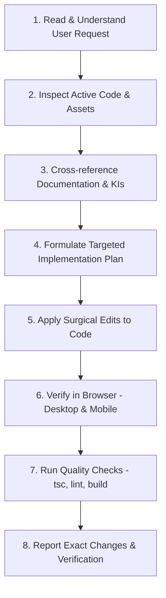

<!-- BEGIN:nextjs-agent-rules -->

## This is NOT the Next.js you know

This version has breaking changes — APIs, conventions, and file structure may all differ from your training data. Read the relevant guide in `node_modules/next/dist/docs/` (resolved from this file's directory; in monorepos the `next` package may not be visible from the repo root) before writing any code. Heed deprecation notices.

This block is written and re-added by `next dev` — verify at `node_modules/next/dist/server/lib/generate-agent-files.js`. Removing it from a diff only re-creates the uncommitted change; committing it with your work keeps the tree clean.

<!-- END:nextjs-agent-rules -->

# AGENTS.md — Working Guidelines for AI Coding Agents

> **Project**: Godwin Apedo Personal Portfolio (`godwin-apedo-portfolio`)  
> **Core Principle**: A request to modify one detail must **never** become permission to redesign an entire section. Every change must be targeted, verified, and consistent with the established design system.

---

## 1. Prime Directives

1. **Inspect Before Editing**: Always inspect the relevant component, style rules, and data structures before writing or replacing code. Understand why code is structured the way it is before proposing modifications.
2. **Targeted Changes Only**: Make surgical, minimal edits that address the user's specific request. Do not refactor unrelated code, change spacing systems, rename classes arbitrarily, or "improve" components that the user did not ask to touch.
3. **Preserve Approved Work**: Layouts, typography, responsive behaviors, assets, animations, and color treatments that have been reviewed and approved must be strictly preserved.
4. **Reuse Established Primitives**:
   - Reuse existing design tokens in `src/app/globals.css`.
   - Reuse centralized motion tokens and helpers in `src/lib/motion.ts`.
   - Reuse motion primitives in `src/components/core/` (`Spotlight`, `InView`, `TextEffect`, `TextScramble`, `InfiniteSlider`, `Tilt`, `Magnetic`, `Dock`).
   - Reuse UI atoms in `src/components/ui/` (`Button`, `Badge`, `CopyEmailButton`, `CopyTextButton`, `SectionHeader`).
5. **No Unnecessary Dependencies**: Do not install new npm packages or icon libraries unless the user explicitly requests them. The project already includes `lucide-react`, `motion`, `tailwind-merge`, and `clsx`.
6. **No Mockups or Placeholders**: Use real, existing assets from `public/images/` and `public/pdf/`. Never invent imaginary file paths or add placeholder graphics.
7. **Accessibility & Reduced Motion**: Always ensure high contrast (`#0f172a` on light surfaces), maintain semantic HTML hierarchy, and honor `prefers-reduced-motion` across all animated components.

---

## 2. Boundaries: Changes Requiring Explicit Approval

AI agents must **not** perform any of the following actions without prior confirmation from the user:

- **Redesigning Sections**: Changing the overall layout, column structure, or conceptual direction of any section.
- **Modifying Color Theme**: Altering the light lavender and glassmorphism visual foundation (`--color-base: #fbfbfe;`, violet accents, glass panels).
- **Removing or Renaming Content**: Deleting projects, technologies, education entries, or altering project contributions and personal narrative.
- **Introducing Dependencies**: Adding state management libraries, CSS frameworks, animation engines, or alternative icon sets.
- **Destructive Git Operations**: Force-pushing, resetting branches, hard resets, switching branches without instruction, or altering Git history.
- **Altering Architecture**: Converting the Next.js App Router structure, removing Turbopack, or moving core directories (`src/content/`, `src/components/`).

---

## 3. Implementation Workflow

When tasked with a code change, agents must follow this sequence:

1. **Locate & View**: Inspect the target component and any connected CSS or content datasets.
2. **Plan**: Define the minimal necessary change. Check if an existing token, component, or utility can be reused.
3. **Edit**: Use targeted code replacement tools. Keep existing comments, docstrings, and props intact.
4. **Browser Verification**:
   - Inspect the rendered result at `http://localhost:3000` (or the active dev port).
   - Verify desktop viewports (`1280px+`) and mobile viewports (`390px`).
   - Confirm hover states, focus states, and animation entrances.
5. **Quality Checks**:
   - `npx tsc --noEmit` (TypeScript strict type check)
   - `npm run lint` (ESLint validation)
   - `npm run build` (Turbopack production build)
6. **Report**: Clearly communicate what file was changed, what was modified, how it was verified, and any remaining open items.

---

## 4. Design & Motion System Adherence

- **Light Lavender Aesthetic**: The project uses a light glassmorphism palette. Do **not** revert to dark-mode styling or generic gray cards.
- **Glassmorphism Classes**: Use `.glass-panel` for major section containers and `.glass-card` for interactive content cards.
- **Text Contrast**: Text on light surfaces must use `text-slate-900` (`#0f172a`) for primary headings, `text-content-secondary` (`#475569`) for body text, and `text-content-muted` (`#64748b`) for captions. Never use low-contrast grays for readable text.
- **Motion Tokens**: All animation durations, easings, distances, and spring configurations must import tokens from `@/lib/motion` rather than using arbitrary inline values.
- **Motion Accessibility**: Always hook into `useReducedMotion()` from `motion/react` and pass `shouldReduceMotion` to motion token generators.

---

## 5. Documentation Synchronization Rules

When an established decision, component API, or section state is modified:
1. Update `MEMORY.md` if project architecture, assets, or section states changed.
2. Update `DESIGN_SYSTEM.md` if new tokens, components, or visual patterns were approved.
3. Update `TASKS.md` to reflect completed items, current status, and new backlog items.
4. If code and documentation diverge, **the code is the primary source of truth**. Never rewrite working code solely to match obsolete documentation; update the documentation to reflect reality.
